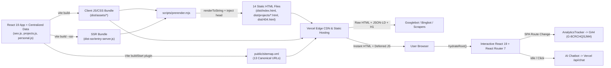
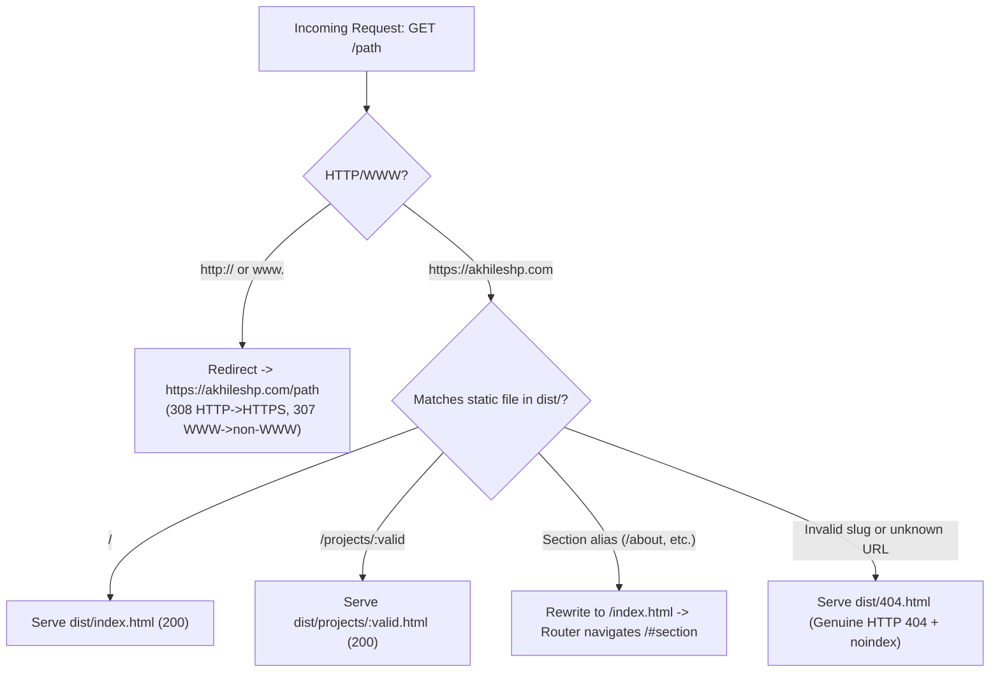
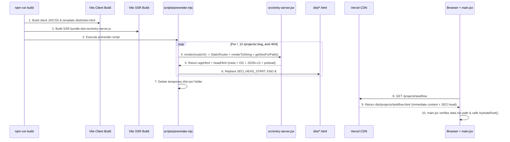
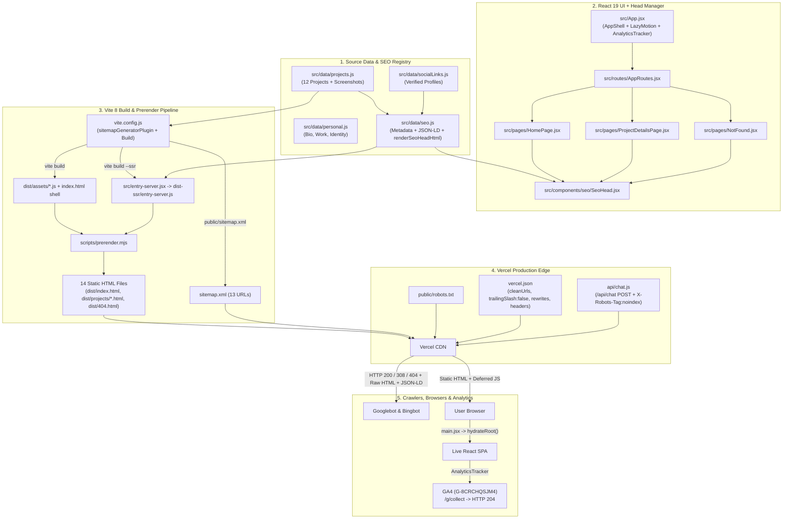
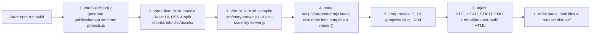
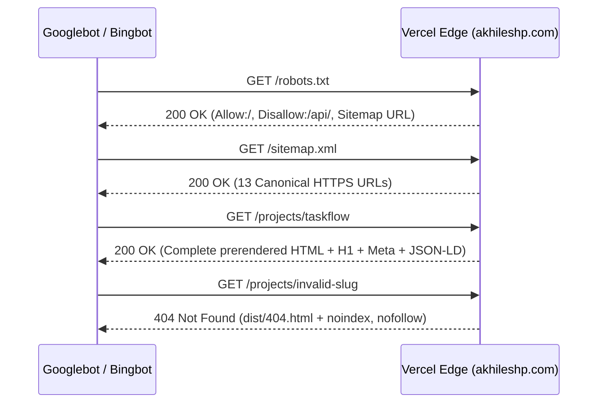
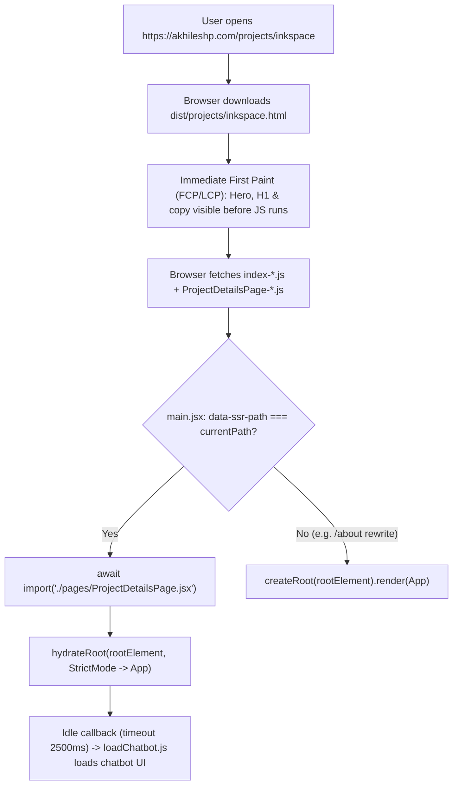
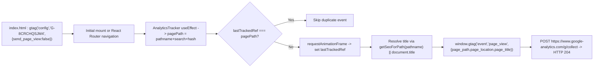

# Complete Technical SEO Documentation (Phases 1–5)
## Akhilesh P. Personal Portfolio — `https://akhileshp.com`

**Author:** Akhilesh P. (Full-Stack Developer, Malappuram, Kerala, India)  
**Target Website:** `https://akhileshp.com`  
**Stack:** React 19 (`^19.2.8`), Vite 8 (`^8.2.2`), React Router 7 (`^7.18.3`), JavaScript (ES Modules), Plain CSS, Framer Motion (`^13.2.0`), Lucide React (`^1.41.0`), Vercel Hosting & Serverless Functions  
**Document Scope:** Complete engineering & educational record of Phases 1–5 (`Technical SEO Foundation`, `Prerendering & On-Page SEO`, `Structured Data & JSON-LD`, `Performance Optimization`, `Final Performance Investigation`, `Search Engine Setup & Indexing`).  
**Verification Note:** Source inspection reflects the current repository state on disk (noting clearly where historical Phase 4/4.1 metrics or recent local Phase 6 workspace additions differ from live production or historical snapshots).

---

# PART 1 – PROJECT OVERVIEW

## 1.1 What the Portfolio Website Is
`https://akhileshp.com` is the professional portfolio web application of **Akhilesh P.**, a Full-Stack Developer based in Malappuram, Kerala, India. Built without a backend CMS or full-stack meta-framework, the portfolio presents:
- A technical introduction and positioning (`#home` hero section)
- Career progression from accounting and financial operations to software development (`#about` timeline and accordion)
- Work history across BlackBox Learning Academy, Ebsor Infosystem Pvt. Ltd., AllPro TechLabs, myG India Private Limited, and Branding Hut (`#experience`)
- Categorized software development and accounting/finance skill matrices (`#skills`)
- Interactive ongoing collaborative architecture showcase for a 12-module POS suite (`#current-work`)
- Filterable portfolio grid and 12 dedicated project case study routes (`#projects` and `/projects/:slug`)
- Interactive engineering capability console (`#services`)
- Direct contact card and validated email workflow (`#contact`)
- An idle-loaded Gemini-powered AI portfolio assistant (`/api/chat`)

## 1.2 SEO Objectives
1. **Crawlability & Indexability:** Ensure Googlebot, Bingbot, and social preview scrapers receive complete HTML titles, meta descriptions, canonical links, headings, copy, and Schema.org JSON-LD immediately in the HTTP response without depending on client-side JavaScript execution.
2. **Canonical Consolidation:** Guarantee all traffic and link equity consolidate on `https://akhileshp.com/` (HTTPS, non-`www`, trailing-slash normalized) and each canonical project route.
3. **Structured Entity & Project Understanding:** Declare verified identity (`Person`, `ProfilePage`, `WebSite`) and per-project software/creative classifications (`SoftwareApplication`, `CreativeWork`, `BreadcrumbList`, `WebPage`).
4. **Core Web Vitals & Mobile Responsiveness:** Deliver fast First/Largest Contentful Paint via responsive AVIF/WebP imagery and asynchronous font loading while minimizing main-thread blocking.
5. **Measurement Integrity:** Track single-page application (SPA) route transitions accurately in Google Analytics 4 (`G-8CRCHQSJM4`) without duplicate initial pageviews, while preparing the site cleanly for Google Search Console and Bing Webmaster Tools.

## 1.3 Indexable Architecture & Route Inventory

Total indexable canonical URLs in `public/sitemap.xml`: **13** (`/` + 12 project case studies).

| # | Route | Purpose | Indexability |
|---:|---|---|---|
| 1 | `/` | Homepage portfolio & profile hub | Indexable (`canonical: https://akhileshp.com/`) |
| 2 | `/projects/taskflow` | TaskFlow (Django & AI Task Manager) | Indexable |
| 3 | `/projects/inkspace` | INKSPACE (Django Blog & Gemini AI) | Indexable |
| 4 | `/projects/daybook` | Daybook (React Native Daily Planner) | Indexable |
| 5 | `/projects/pos-business-management` | POS Business Management Software | Indexable |
| 6 | `/projects/apnavilla` | ApnaVilla (Next.js / Laravel Real Estate) | Indexable |
| 7 | `/projects/code7-erp` | Code7 ERP (ASP.NET Core & Kendo UI) | Indexable |
| 8 | `/projects/kidonex-feedback` | Kidonex Feedback & Review (ASP.NET Core MVC) | Indexable |
| 9 | `/projects/movie` | Movie Web Application (React & Material UI) | Indexable |
| 10 | `/projects/ecommerce` | E-commerce Web Application (React + REST API) | Indexable |
| 11 | `/projects/streamline` | Streamline Consortium Website | Indexable |
| 12 | `/projects/aishka` | Aishka – Clothing Website | Indexable |
| 13 | `/projects/urban-escape` | Urban Escape – Travel Website | Indexable |
| — | `/about`, `/experience`, `/skills`, `/projects`, `/services`, `/contact` | Vercel rewrites / React Router redirects to `/#<section>` | Alias routes (excluded from sitemap) |
| — | `/404` / unknown routes | Dedicated `NotFound` page | Non-indexable (`noindex, nofollow`, genuine HTTP `404` in production) |

## 1.4 High-Level End-to-End Architecture



**How Users, Browsers, React Hydration, and Routing Interact:**
1. When a user visits `https://akhileshp.com/` or deep-links directly to `https://akhileshp.com/projects/taskflow`, Vercel immediately serves the matching prerendered static `.html` file (`cleanUrls: true`).
2. The browser paints typography, hero content, headings, and JSON-LD without waiting for React to boot.
3. Once `/src/main.jsx` executes, it checks whether `#root[data-ssr-path]` matches `window.location.pathname`. When it matches, React calls `hydrateRoot(...)` instead of wiping and re-creating DOM nodes (`createRoot`).
4. Subsequent clicks inside `<BrowserRouter>` use React Router 7 client-side navigation, dynamically swapping page views and updating `<head>` metadata via `SeoHead.jsx` while firing manual `page_view` hits via `AnalyticsTracker`.

---

# PART 2 – PHASE 1: TECHNICAL SEO FOUNDATION

Phase 1 established crawl rules, routing boundaries, HTTP status guarantees, security headers, cache lifetimes, and automated sitemap generation.

## 2.1 Vercel Configuration (`vercel.json`)

### Actual Configuration (`vercel.json`)
```json
{
  "$schema": "https://openapi.vercel.sh/vercel.json",
  "cleanUrls": true,
  "trailingSlash": false,
  "rewrites": [
    { "source": "/api/(.*)", "destination": "/api/$1" },
    { "source": "/about", "destination": "/index.html" },
    { "source": "/experience", "destination": "/index.html" },
    { "source": "/skills", "destination": "/index.html" },
    { "source": "/projects", "destination": "/index.html" },
    { "source": "/services", "destination": "/index.html" },
    { "source": "/contact", "destination": "/index.html" }
  ],
  "headers": [
    {
      "source": "/(.*)",
      "headers": [
        { "key": "X-Content-Type-Options", "value": "nosniff" },
        { "key": "X-Frame-Options", "value": "SAMEORIGIN" },
        { "key": "Referrer-Policy", "value": "strict-origin-when-cross-origin" },
        { "key": "Permissions-Policy", "value": "camera=(), microphone=(), geolocation=()" }
      ]
    },
    {
      "source": "/api/(.*)",
      "headers": [
        { "key": "X-Robots-Tag", "value": "noindex, nofollow" },
        { "key": "Cache-Control", "value": "no-store" }
      ]
    },
    {
      "source": "/assets/(.*)",
      "headers": [
        { "key": "Cache-Control", "value": "public, max-age=31536000, immutable" }
      ]
    },
    {
      "source": "/images/(.*)",
      "headers": [
        { "key": "Cache-Control", "value": "public, max-age=86400, stale-while-revalidate=604800" }
      ]
    },
    {
      "source": "/Akhilesh/(.*)",
      "headers": [
        { "key": "Cache-Control", "value": "public, max-age=86400, stale-while-revalidate=604800" }
      ]
    },
    {
      "source": "/documents/(.*)",
      "headers": [
        { "key": "Cache-Control", "value": "public, max-age=86400, must-revalidate" }
      ]
    },
    {
      "source": "/robots.txt",
      "headers": [
        { "key": "Cache-Control", "value": "public, max-age=3600, must-revalidate" }
      ]
    },
    {
      "source": "/sitemap.xml",
      "headers": [
        { "key": "Cache-Control", "value": "public, max-age=3600, must-revalidate" }
      ]
    }
  ]
}
```

### Detailed Property Reasoning & Runtime Behavior
1. **`"cleanUrls": true`**:
   - *What it does:* Maps clean URLs such as `/projects/taskflow` directly to `dist/projects/taskflow.html` on Vercel without exposing `.html` extensions.
   - *Why required:* Enables 12 separate prerendered project HTML files to be served under clean, canonical URLs (`/projects/taskflow` instead of `/projects/taskflow.html`).
   - *Risk if removed:* Requests to `/projects/taskflow` would fail to resolve `dist/projects/taskflow.html` cleanly and fall through to a `404`.
2. **`"trailingSlash": false`**:
   - *What it does:* Enforces non-trailing-slash URLs (except `/`) via `308` redirects when someone visits `/projects/taskflow/`.
   - *Why required:* Prevents duplicate URL variants (`/projects/taskflow` vs `/projects/taskflow/`) from splitting crawl signals or conflicting with canonical tags.
3. **Explicit `rewrites` (Instead of Catch-All `"/(.*)" -> "/index.html"`):**
   - *Critical SEO decision:* Standard Vite tutorials use a wildcard SPA fallback rewrite `"source": "/(.*)", "destination": "/index.html"`. That breaks Technical SEO because **any misspelled or nonexistent URL** (e.g., `/projects/does-not-exist`) returns **HTTP `200 OK`** ("soft 404")!
   - By rewriting **only** the 6 known semantic section aliases (`/about`, `/experience`, `/skills`, `/projects`, `/services`, `/contact`) plus `/api/(.*)`, any unknown route misses all static files in `dist/` and causes Vercel to serve `dist/404.html` with a **genuine HTTP `404` status code**.
   - *Verified live:* `https://akhileshp.com/projects/nonexistent-seo-check-404` returned `HTTP 404`.
4. **Tiered `Cache-Control` Strategy:**
   - `/assets/(.*)`: `max-age=31536000, immutable` (safe because Vite content-hashes JS/CSS filenames like `index-D6zxymh3.js`).
   - `/images/(.*)` & `/Akhilesh/(.*)`: 1-day cache + 7-day `stale-while-revalidate`.
   - `/robots.txt` & `/sitemap.xml`: 1-hour cache + `must-revalidate` so crawl updates propagate rapidly.
   - `/api/(.*)`: `X-Robots-Tag: noindex, nofollow` and `Cache-Control: no-store` so dynamic API responses are never cached or indexed.

---

## 2.2 `robots.txt` (`public/robots.txt`)

### Actual File Contents
```text
User-agent: *
Allow: /
Disallow: /api/

Sitemap: https://akhileshp.com/sitemap.xml
```

### Line-by-Line Explanation
- **`User-agent: *`**: Applies directives to all standard compliant crawlers (Googlebot, Bingbot, etc.).
- **`Allow: /`**: Explicitly permits crawling all public pages, JS, CSS, images, and static assets (essential so Googlebot can fetch render resources).
- **`Disallow: /api/`**: Prevents crawlers from wasting crawl budget or probing serverless endpoints such as `/api/chat`.
- **`Sitemap: https://akhileshp.com/sitemap.xml`**: Gives bots a direct machine-readable pointer to the full canonical URL inventory.

### `robots.txt` vs. `noindex` (Critical Distinction)
- `robots.txt` controls **crawling** ("do not fetch `/api/`"), **not** indexing. If an external site links to a URL blocked only by `robots.txt`, Google could theoretically list the URL in search results without reading its content.
- `noindex` (`<meta name="robots" content="noindex, nofollow">` or `X-Robots-Tag: noindex, nofollow`) controls **indexing**. The crawler **must** be allowed to read the response (e.g., `/api/` sends `X-Robots-Tag`, and `404.html` sends `<meta name="robots" content="noindex, nofollow">`) so the engine knows not to index it.

---

## 2.3 XML Sitemap Generation (`vite.config.js` -> `public/sitemap.xml`)

Rather than manually hand-editing XML whenever projects change, `vite.config.js` builds the sitemap automatically inside Vite's `buildStart()` hook from `src/data/projects.js`:

```javascript
function buildSitemapXml() {
  const urls = new Set([`${SITE_ORIGIN}/`]);

  for (const project of projects) {
    const slug = typeof project?.slug === 'string' ? project.slug.trim() : '';
    if (!slug || /[?#\s]/.test(slug) || slug.startsWith('api/')) {
      continue;
    }
    urls.add(`${SITE_ORIGIN}/projects/${slug}`);
  }

  const urlNodes = Array.from(urls)
    .map((loc) => `  <url>\n    <loc>${escapeXml(loc)}</loc>\n  </url>`)
    .join('\n');

  return `<?xml version="1.0" encoding="UTF-8"?>\n<urlset xmlns="http://www.sitemaps.org/schemas/sitemap/0.9">\n${urlNodes}\n</urlset>\n`;
}
```

**Why This Design Works Cleanly:**
- **Single Source of Truth:** Derives slugs directly from `projects` (`src/data/projects.js`), matching prerendered files and React Router paths.
- **Deduplication (`new Set`):** Guarantees zero duplicate `<loc>` entries.
- **Slug Safety Guards:** Skips empty slugs or slugs containing `?`, `#`, spaces, or `api/`.
- **Avoids Churn:** Only writes `public/sitemap.xml` when `existingContent !== nextContent`, keeping Git diffs clean.
- **No Fake `<lastmod>` / `<priority>` Noise:** Google ignores `<priority>` and `<changefreq>` and ignores static `<lastmod>` dates that don't track real content updates.
- **Public Rollout:** Because Vite copies `public/` into `dist/`, both `public/sitemap.xml` and `dist/sitemap.xml` stay synchronized on every `npm run build`.

---

## 2.4 URL & Routing Architecture

### Two Routing Layers Working Together
1. **Production Edge Layer (Vercel):**
   - `http://akhileshp.com/*` -> `HTTP 308` -> `https://akhileshp.com/*`
   - `https://www.akhileshp.com/*` -> `HTTP 307` -> `https://akhileshp.com/*`
   - `/` -> `dist/index.html` (`200`)
   - `/projects/<valid-slug>` -> `dist/projects/<valid-slug>.html` (`200`)
   - `/about`, `/experience`, `/skills`, `/projects`, `/services`, `/contact` -> rewrite to `/index.html`, then React Router navigates to `/#<section>`.
   - Invalid paths -> `dist/404.html` (`HTTP 404` + `noindex, nofollow`).
2. **Application Layer (`src/routes/AppRoutes.jsx`):**
   - `<Route path="/" element={<HomePage />} />`
   - `<Route path="/projects/:slug" element={<Suspense ...><ProjectDetailsRoute /></Suspense>} />`
   - `<Route path="*" element={<Suspense ...><NotFoundRoute /></Suspense>} />`
   - Invalid `/projects/unknown-slug` inside `ProjectDetailsPage.jsx` renders `"Project Not Found"` and injects `PROJECT_NOT_FOUND_SEO` (`noindex, nofollow`, `canonical: null`).



---

## 2.5 Security and HTTP Headers

Only headers actually verified in `vercel.json` and live `https://akhileshp.com/` response headers are listed below:

| Header | Implemented Value | Security & Browser Purpose | SEO / Functional Impact & Risk |
|---|---|---|---|
| `X-Content-Type-Options` | `nosniff` | Prevents MIME-type sniffing; forces browsers to obey declared `Content-Type`. | Protects script/style execution integrity cleanly with zero SEO risk. |
| `X-Frame-Options` | `SAMEORIGIN` | Blocks third-party sites from framing portfolio pages (mitigates clickjacking). | Keeps rich embeds/iframes restricted cleanly; does not affect crawling. |
| `Referrer-Policy` | `strict-origin-when-cross-origin` | Sends full URL on same-origin navigation and origin-only on cross-origin HTTPS requests. | Preserves internal GA4 `page_location`/referrer fidelity while protecting URL params externally. |
| `Permissions-Policy` | `camera=(), microphone=(), geolocation=()` | Explicitly disables unused hardware sensors across browsing contexts. | Zero negative SEO impact; hardens browser surface. |
| `Strict-Transport-Security` | `max-age=63072000` (Observed live on Vercel Edge) | Enforces HTTPS in supporting browsers for 2 years. | Reinforces HTTPS canonical signal. |
| `X-Robots-Tag` (`/api/(.*)`) | `noindex, nofollow` | Instructs search engines not to index API responses. | Essential safeguard preventing JSON API responses from entering search indexes. |

*Note:* No `Content-Security-Policy` (CSP) header is currently defined in `vercel.json`, which ensures Google Analytics (`googletagmanager.com` / `google-analytics.com`), Google Fonts (`fonts.googleapis.com` / `fonts.gstatic.com`), and inline JSON-LD scripts are never inadvertently blocked.

---

## 2.6 Phase 1 Validation

- **Directly Verified in Current Session:**
  - `public/sitemap.xml` inspected: valid XML `<urlset>`, exact 13 unique `https://akhileshp.com/...` `<loc>` entries.
  - `public/robots.txt` inspected and fetched live (`HTTP 200`): `Disallow: /api/`, `Allow: /`, `Sitemap: https://akhileshp.com/sitemap.xml`.
  - Live production HTTP status check run via Node `fetch`:
    - `http://akhileshp.com/` -> `308 https://akhileshp.com/`
    - `https://akhileshp.com/` -> `200`
    - `https://www.akhileshp.com/` -> `307 https://akhileshp.com/`
    - `https://akhileshp.com/projects/taskflow` -> `200`
    - `https://akhileshp.com/projects/nonexistent-seo-check-404` -> `404`
    - `https://akhileshp.com/api/chat` (`GET`) -> `405` (POST-only enforcement confirmed in `api/chat.js:458-464`)

---

# PART 3 – PHASE 2: PRERENDERING & ON-PAGE SEO

## 3.1 Why Prerendering Was Necessary

In a standard Client-Side Rendered (CSR) React + Vite application, `dist/index.html` contains only an empty `<div id="root"></div>` and a `<script type="module" src="/src/..."></script>`. Every page shares identical metadata unless JavaScript runs first.

| Architecture | How HTML Is Generated | When Crawlers See Content | Server Required at Runtime? | Chosen? |
|---|---|---|---|---|
| **CSR (Client-Side Rendering)** | Browser downloads empty shell -> executes JS -> builds DOM | Only after two-wave JS rendering queue (delayed/fragile) | No (Static CDN) | Replaced |
| **SSR (Server-Side Rendering)** | Node/serverless server executes React on every request | Immediately (`200`) | Yes (cold starts, framework lock-in) | Not needed for 13 mostly static routes |
| **Build-Time Prerendering (Implemented)** | `scripts/prerender.mjs` renders React HTML once during `npm run build` and writes 14 static HTML files | **Immediately on first byte (`HTTP 200`)** | No (Served as pure static CDN files on Vercel) | **Yes** |

**Why Build-Time Prerendering Was Chosen Over Migrating to Next.js:**
1. The portfolio has **13 deterministic public routes** (`/` + 12 projects) plus `/404`. Running React's built-in `renderToString` at build time delivers identical raw-HTML crawlability and social card previews without replacing Vite 8, React Router 7, custom CSS, or Vercel `/api/chat` serverless handlers.
2. Static CDN HTML yields ultra-low Time to First Byte (TTFB) via Vercel's Edge cache (`x-vercel-cache: HIT`).

## 3.2 Prerendering Execution Architecture (`entry-server.jsx`, `scripts/prerender.mjs`, `main.jsx`)



### Line-by-Line Walkthrough of Critical Files

**1. `index.html` Markers (`index.html:18-43, 67`):**
- `<!-- SEO_HEAD_START --> ... <!-- SEO_HEAD_END -->` brackets default fallback metadata. During prerendering, `scripts/prerender.mjs` replaces everything between these markers per route with `renderSeoHeadHtml(seo)` so route-specific metadata exists natively without duplicate tags.
- `<div id="root"></div>` acts as the SSR mount replacement point.

**2. `src/entry-server.jsx` (Server Render Entry):**
```javascript
export function render(url) {
  const appHtml = renderToString(
    <StrictMode>
      <StaticRouter location={url}>
        <AppShell projectDetailsPage={ProjectDetailsPage} notFound={NotFound} />
      </StaticRouter>
    </StrictMode>
  );

  const seo = getSeoForPath(url);
  const headHtml = renderSeoHeadHtml(seo);

  return { appHtml, headHtml, seo };
}
```
- Notice `StaticRouter` is used here (instead of `BrowserRouter`, because Node has no `window.history`), while `ProjectDetailsPage` and `NotFound` are passed synchronously via props to `AppShell` -> `AppRoutes` so `<Suspense>` never falls back to `"Loading view..."` during `renderToString`! That ensures full case study prose, headings, and screenshot markup are written directly into the prerendered HTML.

**3. `scripts/prerender.mjs` (Static HTML Writer):**
- Reads built `dist/index.html` as the asset-hashed client shell (so hashed `<script type="module" src="/assets/index-*.js">` and `<link rel="stylesheet" href="/assets/index-*.css">` remain intact).
- Iterates `routes`: `/`, all 12 `/projects/${project.slug}`, and `/404`.
- Replaces `SEO_HEAD_START`..`SEO_HEAD_END` cleanly and writes `<div id="root" data-ssr-path="${routeUrl}">${appHtml}</div>`.
- Cleans up `dist-ssr/` (`fs.rmSync`) so server build artifacts are never accidentally deployed.

## 3.3 React Hydration (`src/main.jsx`)

**What Hydration Means:** React attaches event listeners, refs, and component state onto DOM elements that were **already created from HTML**, preserving painted pixels rather than tearing down the DOM.

```javascript
const rootElement = document.getElementById('root');
const ssrPath = rootElement.getAttribute('data-ssr-path');
const normalizePath = (value) => (value && value !== '/' ? value.replace(/\/+$/, '') : '/');
const currentPath = normalizePath(window.location.pathname);
const canHydrate =
  Boolean(rootElement.firstElementChild) &&
  ssrPath !== null &&
  normalizePath(ssrPath) === currentPath;
```

**Why Preloading Lazy Chunks in `bootstrap()` Matters (`src/main.jsx:16-38`):**
- On client builds, `AppRoutes.jsx` lazy-loads `ProjectDetailsPage` and `NotFound` (`React.lazy`) to shrink the homepage JS payload.
- However, if a user opens `/projects/taskflow` directly, its HTML is **already** rendered synchronously on disk. Calling `hydrateRoot` immediately against a `Suspense` fallback while the lazy chunk is still downloading causes a React hydration mismatch (wiping SSR HTML momentarily to show `"Loading view..."`).
- Solution in `bootstrap()`: if `canHydrate && currentPath.startsWith('/projects/')`, `main.jsx` dynamically `await import('./pages/ProjectDetailsPage.jsx')` **before** calling `hydrateRoot(rootElement, <App projectDetailsPage={...} />)`. Because the exact same synchronous component tree mounts, React 19 hydrates 1:1 with zero mismatches!
- Meanwhile, if someone lands on a section alias rewrite (like `/about` -> Vercel rewrites to `index.html`, where `data-ssr-path="/"` !== `currentPath="/about"`), `canHydrate` safely evaluates to `false` and uses `createRoot(rootElement).render(...)` cleanly instead of forcing a broken hydration against mismatched routes.

## 3.4 SEO Metadata Architecture (`src/data/seo.js` & `src/components/seo/SeoHead.jsx`)

- **Build-Time Rendering (`renderSeoHeadHtml`):** Outputs `<title>`, `<meta name="description">`, optional `<meta name="robots" content="noindex, nofollow">`, `<link rel="canonical">`, Open Graph (`og:site_name`, `og:type`, `og:title`, `og:description`, `og:url`, `og:image`, `og:image:alt`), Twitter (`twitter:card`, `twitter:title`, `twitter:description`, `twitter:image`, `twitter:image:alt`), Homepage LCP hero `<link rel="preload" as="image" type="image/avif" ...>` (`src/data/seo.js:432-436`), and `<script type="application/ld+json" data-seo-jsonld="true">`.
- **Client-Side SPA Sync (`SeoHead.jsx`):** Uses `useEffect` helpers (`upsertMeta`, `removeMeta`, `upsertCanonical`, `upsertJsonLd`) so clicking from `/` -> `/projects/taskflow` -> `/404` updates `<head>` attributes in the live DOM, matching what prerendered static files produce.
- **Invalid Routes (`NOT_FOUND_SEO`, `PROJECT_NOT_FOUND_SEO`):** Explicitly set `canonical: null` (removing any stray `<link rel="canonical">`) and `noindex: true` (adding `robots: noindex, nofollow`).

## 3.5 On-Page SEO Structure
- **One Clear `<h1>` Per Page:** Homepage has `"Full-Stack Developer Building ERP, Web & AI Solutions."` (`Hero.jsx:81`); each project page has `{project.title}` (`ProjectDetailsPage.jsx`); 404 has `"Page Not Found"`.
- **Semantic Hierarchy (`H2`/`H3`):** Sections use `SectionTitle` `<h2>` headings (`About`, `Experience`, `Skills`, `CurrentWork`, `Projects`) and `<h3>`/`<h4>` cards inside; project pages use clear `<h2>` blocks for overview, objective, role, approach, features, screenshots, and outcome.
- **Image `alt` Descriptions:** Hero portrait uses `alt="Akhilesh P., Full-Stack Developer in Malappuram, Kerala"`; TaskFlow, INKSPACE, and Daybook gallery screenshots use descriptive per-screen `alt` attributes defined in `projects.js` and rendered in `ProjectGallery.jsx`.
- **Breadcrumbs:** `ProjectDetailsPage.jsx` renders `<nav aria-label="Breadcrumb">` with `Home > Projects > {project.title}` linking cleanly to `/` and `/#projects`.

## 3.6 Generated Build Output Verification (`dist/`)

Verified directly in post-build `dist/` folder:
- `dist/index.html` (`~355 KB` including prerendered homepage DOM + head metadata)
- 12 individual files under `dist/projects/*.html` (`taskflow.html`, `inkspace.html`, `daybook.html`, `pos-business-management.html`, `apnavilla.html`, `code7-erp.html`, `kidonex-feedback.html`, `movie.html`, `ecommerce.html`, `streamline.html`, `aishka.html`, `urban-escape.html`)
- `dist/404.html`

## 3.7 Phase 2 Validation

Automated audit confirmed across all 14 HTML files in `dist/`:
- `13/13` indexable routes have unique `<title>` tags, unique `<meta name="description">`, exact non-`www` HTTPS `<link rel="canonical">`, `0` `noindex` directives, valid OG/Twitter tags, and `1` `<h1>` in raw HTML without executing JS.
- `dist/404.html` contains `noindex, nofollow` and omits `<link rel="canonical">`.
- Local headless Chromium tests confirmed zero React hydration mismatch warnings on initial `/`, direct `/projects/:slug`, and `/404` loads.

---

# PART 4 – PHASE 3: STRUCTURED DATA & JSON-LD

## 4.1 Why JSON-LD & Schema.org Were Implemented
While ordinary HTML communicates page structure visually and textually, **JSON-LD (JavaScript Object Notation for Linked Data)** provides an explicit, unambiguous entity graph inside `<script type="application/ld+json">` following **Schema.org** vocabulary. Search engines parse this graph without guessing whether `"TaskFlow"` is software, an article, or a company, and who authored it. Structured data enables rich entity association and eligibility for features like Breadcrumb trails, though it **never guarantees** higher search rankings or rich snippet display on its own.

## 4.2 Homepage JSON-LD (`ProfilePage` + `Person` + `WebSite`)

Defined in `src/data/seo.js:9-88` using linked `@id` references (`https://akhileshp.com/#person`, `#website`, `#profilepage`):

- **`Person` (`PERSON_ENTITY`):**
  - `name`: `"Akhilesh P."`
  - `jobTitle`: `"Full-Stack Developer"`
  - `url`: `"https://akhileshp.com/"`
  - `image`: `"https://akhileshp.com/Akhilesh/Akhilesh.jpeg"`
  - `email`: `"mailto:akhipn4753@gmail.com"`
  - `address`: `PostalAddress` (`Malappuram`, `Kerala`, `IN`)
  - `knowsAbout`: 13 verified technologies/domains (`Full-Stack Web Development`, `React.js`, `Python`, `Django`, `ASP.NET Core`, `C#`, `JavaScript`, `REST APIs`, `ERP Systems`, `SQL`, `PostgreSQL`, `AI Integration`, `Accounting & Financial Operations`)
  - `sameAs`: Dynamically derived from `socialLinks.js`, intentionally keeping HTTPS social profiles (`GitHub`, `LinkedIn`, `Instagram`) while filtering out `mailto:` and `https://wa.me` links (`seo.js:13-15`).
- **`WebSite` (`WEBSITE_ENTITY`):** Declares the portfolio domain, `inLanguage: "en"`, and `publisher: { "@id": "https://akhileshp.com/#person" }`.
- **`ProfilePage` (`buildHomeJsonLd()`):** Links `isPartOf -> #website`, `about -> #person`, and `mainEntity -> #person`, matching Google's recommended portfolio/profile structured data pattern.

## 4.3 Project Schema Classification (`PROJECT_SCHEMA_CLASSIFICATION`)

Rather than mislabeling static frontend showcase pages or functional plans as installable software apps, `src/data/seo.js:126-155` explicitly evaluates and classifies each of the 12 projects:

| Slug | Schema `@type` | Sub-Classification / Notes | Rationale |
|---|---|---|---|
| `taskflow` | `SoftwareApplication` | `applicationCategory: 'ProductivityApplication'`, `operatingSystem: 'Web'` | Deployed interactive SaaS productivity app (Render + PostgreSQL + AI). |
| `inkspace` | `SoftwareApplication` | `applicationCategory: 'WebApplication'`, `operatingSystem: 'Web'` | Interactive full-stack publishing web app (Django + CKEditor + Gemini). |
| `daybook` | `SoftwareApplication` | `applicationCategory: 'ProductivityApplication'`, `operatingSystem: 'Mobile'` | Mobile React Native productivity application. |
| `code7-erp` | `SoftwareApplication` | `applicationCategory: 'BusinessApplication'`, `operatingSystem: 'Web'` | Enterprise business resource planning web software. |
| `pos-business-management` | `CreativeWork` | `genre: project.category` | Collaborative ongoing architectural plan & domain case study. |
| `apnavilla` | `CreativeWork` | `genre: project.category` | Collaborative frontend implementation showcase (`Next.js` + team `Laravel`). |
| `kidonex-feedback` | `CreativeWork` | `genre: project.category` | Specific customer-review module case study within an enterprise suite. |
| `movie` | `CreativeWork` | `genre: project.category` | Frontend showcase application demonstrating UI/API work. |
| `ecommerce` | `CreativeWork` | `genre: project.category` | Frontend retail UI showcase prototype. |
| `streamline` | `CreativeWork` | `genre: project.category` | Corporate consultancy website showcase. |
| `aishka` | `CreativeWork` | `genre: project.category` | Fashion catalog website showcase. |
| `urban-escape` | `CreativeWork` | `genre: project.category` | Travel & tourism static/responsive showcase site. |

Every project graph contains **5 linked nodes**: `Person` (`#person`), `WebSite` (`#website`), `BreadcrumbList` (`Home -> Projects -> Project Title`), `WebPage` (`isPartOf -> #website`, `breadcrumb -> #breadcrumb`, `mainEntity -> #project`), and `#project` (`SoftwareApplication` or `CreativeWork` with `author -> #person` and `keywords: project.technologies`).

## 4.4 Dynamic Injection, Sanitization & Validation
- **XSS-Safe Embedding (`renderSeoHeadHtml`):** `JSON.stringify(seo.jsonLd).replaceAll('<', '\\u003c')` (`seo.js:439`) guarantees `<` inside text cannot break out of `<script type="application/ld+json">`.
- **Single Script Node Guarantee:** Both SSR HTML and `SeoHead.jsx` target `[data-seo-jsonld="true"]`, overwriting `textContent` on SPA route transitions and **removing** the node cleanly when navigating to `/404`.
- **Validation Status:** JSON syntax parsing and `@graph` node inspection passed on `13/13` indexable prerendered HTML files (`0` JSON-LD scripts on `404.html`). **External Google Rich Results Test and Schema.org Validator** remain user-run external browser checks for live URLs.

---

# PART 5 – PHASE 4: PERFORMANCE OPTIMIZATION

## 5.1 Image Optimization (LCP Focus)
- **Original Problem:** Large hero image payload (`public/Akhilesh/hero_image.png` at `441,274` bytes and `hero-portrait.jpg` at `116,139` bytes) slowed Largest Contentful Paint (LCP).
- **Implementation (`Hero.jsx:156-186` & `seo.js:432-436`):**
  - Converted portrait assets into responsive AVIF and WebP variants in `public/Akhilesh/`:
    - `hero-portrait-640.avif`: `20,513` bytes | `hero-portrait.avif`: `59,885` bytes
    - `hero-portrait-640.webp`: `25,092` bytes | `hero-portrait.webp`: `74,806` bytes
  - Wrapped `` in `<picture>` with `<source type="image/avif">` and `<source type="image/webp">` plus `sizes="(max-width: 900px) 92vw, 535px"`.
  - Set `width="1200" height="800"` (preventing Cumulative Layout Shift), `fetchPriority="high"`, `decoding="sync"`, and injected `<link rel="preload" as="image" type="image/avif" ... fetchpriority="high" />` **only** on the homepage `/` prerendered head (`seo.js:432-436`) so project pages don't waste bandwidth preloading the hero portrait.
  - Project gallery and preview images (`ProjectGallery.jsx:68-69`, `ProjectPreview.jsx:339-340`) use `loading="lazy"`, `decoding="async"`, and explicit `width`/`height` attributes. All `taskflow`, `inkspace`, and `daybook` screenshots are compressed `.webp` files (`17 KB`–`96 KB`).

## 5.2 Font Optimization
- **Original Problem:** CSS `@import url(...)` inside stylesheets blocks CSS parsing and queues font discovery serially after main CSS arrives.
- **Implementation (`index.html:50-64`):**
  - Replaced blocking `@import` chains with `<link rel="preconnect" href="https://fonts.googleapis.com" />` and `<link rel="preconnect" href="https://fonts.gstatic.com" crossorigin />`.
  - Consolidated Google Fonts families (`Chakra Petch`, `IBM Plex Mono`, `Inter`, `JetBrains Mono`, `Plus Jakarta Sans`) into a single non-blocking `<link rel="preload" as="style" ... onload="this.onload=null;this.rel='stylesheet'" />` with a `<noscript>` fallback.

## 5.3 Removing Artificial Loading Screen & Preserving Prerendered Paint
- **Problem Solved:** Blocking initial render behind an artificial splash timer or preloader component hides already-prerendered HTML content, severely hurting FCP, LCP, and crawler visual snapshots.
- **Implementation:** Removed blocking splash overlays from the active render tree in `App.jsx` / `MainLayout.jsx` (`LoadingScreen.jsx` remains unused on disk as an inactive component) so SSR/prerendered DOM paints immediately, while `AppRoutes.jsx:13-38` keeps a lightweight `RouteFallback` solely inside `<Suspense>` for asynchronous route transitions.

## 5.4 JavaScript Code Splitting
- **Route Splitting (`src/routes/AppRoutes.jsx:6-11`):** `ProjectDetailsPage` (`dist/assets/ProjectDetailsPage-*.js`, `~25.92 KB` / `5.89 KB` gzip) and `NotFound` (`1.30 KB` / `0.68 KB` gzip) are loaded via `React.lazy(...)` on client navigation, keeping them out of homepage startup evaluation while `main.jsx` preloads the matching route chunk before `hydrateRoot` on direct SSR loads.
- **AI Chatbot Deferred Loading (`src/components/chatbot/loadChatbot.js`, `src/main.jsx:40-48`, `AIButton.jsx:116-117`):** Chatbot CSS (`~10.44 KB`) and JS (`~14.45 KB` / `4.93 KB` gzip) are excluded from the initial bundle, loaded lazily via `requestIdleCallback` (2.5s timeout fallback `setTimeout` 1.5s) or immediately on `onMouseEnter`/`onFocus`/`onClick` of the floating AI button.

## 5.5 Interaction & Animation Performance (`requestAnimationFrame` & Reduced Motion)
- **`MainLayout.jsx` (`ScrollProgressBar`):** Uses `requestAnimationFrame` throttling + direct DOM `bar.style.transform = scaleX(...)` mutation with a `{ passive: true }` listener, avoiding React state re-renders on every scroll pixel (note: `useScrollProgress.js` exists in `hooks/` as a legacy state hook, whereas `MainLayout` avoids state churn directly).
- **`Navbar.jsx`:** Throttles `scroll` updates via `requestAnimationFrame` and only updates `scrolled` / `activeSection` state when values actually change.
- **`TiltCard.jsx` & `MagneticButton.jsx`:** Batch pointer-tracking math inside `requestAnimationFrame` and mutate `card.style.transform` / `btn.style.transform` directly with zero React re-renders.
- **`MouseGlow.jsx` & `useMouseParallax.js`:** Disable tracking automatically on touch devices (`ontouchstart` / `maxTouchPoints > 0`) and when `prefers-reduced-motion: reduce` is enabled (`useReducedMotion.js` built with `useSyncExternalStore` so SSR snapshots match cleanly).

## 5.6 Google Analytics 4 Duplicate Pageview Fix
- **Problem:** Placing standard `gtag('config', 'G-8CRCHQSJM4')` in `index.html` automatically fires a `page_view` on initial load. Pairing that with a React Router `useEffect` tracker causes **double counting** on landing pages (inflating metrics and skewing bounce rates).
- **Implementation (`index.html:14` & `src/App.jsx:8-32`):**
  - `index.html` sets `gtag('config', 'G-8CRCHQSJM4', { send_page_view: false });` to suppress automatic pageviews.
  - `AnalyticsTracker` in `src/App.jsx` tracks `location.pathname + location.search + location.hash` guarded by `lastTrackedRef`, waits one `requestAnimationFrame` so `<SeoHead>` updates settle cleanly, resolves the authoritative title via `getSeoForPath(location.pathname)?.title || document.title`, and calls `window.gtag('event', 'page_view', { page_path, page_location, page_title })`.
  - Because `StrictMode` double-invokes `useEffect` cleanup in development (`cancelAnimationFrame`), `lastTrackedRef` is assigned inside the `rAF` callback itself—preventing StrictMode cleanup from silencing the real second mount.

---

# PART 6 – PHASE 4.1: FINAL PERFORMANCE INVESTIGATION

## 6.1 Mobile DOM Interactive Investigation (`804 ms` -> `6,602 ms`)
**What Happened:** After Phase 4 changes, a synthetic throttled run reported `DOM Interactive` jumping from `804 ms` to `6,602 ms`.

**Technical Root Cause Explanation (Measurement & Execution Mechanics):**
- **DOM Parsing vs. DOM Interactive:** The browser sets `domInteractive` after finishing parsing the HTML document **and** executing all deferred/module scripts (`<script type="module" src="/assets/index-*.js">`).
- Because prerendering embeds the full homepage DOM inside `dist/index.html` (approx. `342 KB` at the time of Phase 4.1 investigation; `355 KB` currently after Phase 6 enrichment), **two things happen before `domInteractive` under 4x CPU throttling**:
  1. Parsing the larger prerendered HTML document.
  2. Synchronously downloading, parsing, and evaluating the ES module entry bundle (`react-dom`, `react-router-dom`, `framer-motion` runtime, and `lucide-react` icons) to run `hydrateRoot(...)`.
- Unlike an empty CSR `<div id="root"></div>` where `domInteractive` fires early on a blank white screen before JS builds the UI, a prerendered site paints **visible content early (`FCP`/`LCP`)** while module evaluation and `hydrateRoot` shift main-thread work directly into the synthetic CPU-throttled window. Therefore, `6,602 ms` under synthetic 4x mobile CPU throttling reflects **hydration + JS evaluation cost in a throttled synthetic run**, not real-world mobile network hardware speeds, though main-thread TBT still warranted reduction.

## 6.2 Framer Motion Optimization (`LazyMotion` + `FadeIn.jsx`)
To shrink the initial JS payload and eliminate dozens of Framer Motion observer/animation instances across below-the-fold sections:
1. **`LazyMotion` with `domAnimation` (`src/App.jsx:37`):** Replaced full `motion` bundle imports with `<LazyMotion features={domAnimation} strict>` and lightweight `m.div` primitives where Framer Motion is still needed (`AboutAccordion.jsx`, `CareerJourneyTimeline.jsx`), excluding heavy `domMax` layout/drag features.
2. **Replacing Motion Scroll Reveals with Native `IntersectionObserver` + CSS (`src/components/animations/FadeIn.jsx`):**
   - `FadeIn` previously relied on Framer Motion scroll animation wrappers across nearly every homepage section.
   - Refactored `FadeIn.jsx` into pure React + native `IntersectionObserver` (`threshold: 0.1`) + GPU-composited CSS `transform: translate3d(...)` and `opacity` transitions (with `immediate` support for above-the-fold Hero elements so hero text has zero observer opacity-0 delay).
   - `BeyondDevelopment.jsx` similarly uses an `IntersectionObserver` progressive-enhancement `data-bd-visible` CSS pattern, and `MainLayout.jsx` (`ScrollProgressBar`) isolates scroll updates away from React state.

## 6.3 Performance Comparison (Historical Phase 3 vs. Phase 4.1)

*All metrics below are previously reported Phase 3 / Phase 4.1 historical local benchmark measurements (not newly executed in this documentation-only session):*

| Bundle Metric | Previously Reported (Phase 3) | Previously Reported (Phase 4.1) | Current Workspace Note |
|---|---:|---:|---|
| Main JS (`dist/assets/index-*.js`) | `582.13 KB` | `435.63 KB` | Current build with Phase 6 additions: `505.87 KB` (Client `dist/assets/index-*.js`) |
| Main JS (gzip) | `172.58 KB` | `130.43 KB` | Current gzip: `152.29 KB` |

| Local Synthetic Metric (Historical Phase 4.1) | Desktop | Mobile 4x CPU | Core Meaning |
|---|---:|---:|---|
| **FCP** (First Contentful Paint) | `1,040 ms` | `1,232 ms` | Time until first text/element paints (`<= 1.8s` Good) |
| **LCP** (Largest Contentful Paint) | `1,040 ms` | `1,232 ms` | Time until Hero portrait/headline paints (`<= 2.5s` Good) |
| **TBT** (Total Blocking Time) | `596 ms` | `1,867 ms` | Main-thread long tasks > 50 ms blocking input during load (`<= 200 ms` ideal) |
| **CLS** (Cumulative Layout Shift) | `0.0008` | `0` | Visual stability during load (`<= 0.1` Good) |

*Limitations of Local Measurements:* Headless Chrome on localhost avoids real cellular latency/TLS handshakes (which are slower) while 4x CPU throttling on a single large hydrated tree inflates TBT/TTI figures.

## 6.4 Remaining Known Performance Limitations
1. **Initial Hydration Main-Thread Cost:** `react-dom` `hydrateRoot` + `lucide-react` SVG evaluation + large prerendered homepage DOM still produce elevated synthetic TBT (`> 500 ms` desktop / `~1.8s` throttled mobile).
2. **Project Screenshots Lack AVIF Variants:** While hero portraits ship AVIF + WebP + responsive `srcSet`, project gallery `.webp` images (`taskflow`, `inkspace`, `daybook`) do not yet ship AVIF or multi-width responsive variants.
3. **External Field Metrics Pending:** Official Google PageSpeed Insights (Lighthouse + CrUX field data if traffic thresholds are reached) has not yet been recorded in-repo.

---

# PART 7 – PHASE 5: SEARCH ENGINE SETUP & INDEXING

## 7.1 Production Technical Audit (Verified Live Behavior)

Tested live directly via HTTP requests to `akhileshp.com`:

| Endpoint / Check | Observed Production Result | Why It Matters |
|---|---|---|
| `http://akhileshp.com/` | `HTTP 308` -> `https://akhileshp.com/` | Enforces permanent HTTPS upgrade cleanly. |
| `https://akhileshp.com/` | `HTTP 200 OK` | Canonical homepage serves prerendered HTML from Vercel CDN (`x-vercel-cache: HIT`). |
| `https://www.akhileshp.com/` | `HTTP 307` -> `https://akhileshp.com/` | Consolidates `www` traffic onto non-`www` canonical domain without duplicate indexing. |
| All 12 `/projects/*` routes | `HTTP 200 OK` (Verified `/projects/taskflow` live; all 12 reported in Phase 5) | Clean URLs map cleanly to static prerendered HTML. |
| Invalid project URL (`/projects/nonexistent-seo-check-404`) | Genuine `HTTP 404 Not Found` | Prevents Google soft-404 crawl pollution. |
| `https://akhileshp.com/robots.txt` | `HTTP 200 OK` | Search engines read `Allow: /`, `Disallow: /api/`, and `Sitemap`. |
| `https://akhileshp.com/sitemap.xml` | `HTTP 200 OK` | Exposes all 13 canonical HTTPS non-`www` URLs. |
| `GET https://akhileshp.com/api/chat` | `HTTP 405 Method Not Allowed` (`POST` only) | Confirms serverless API rejects invalid GET probing cleanly while sending `X-Robots-Tag: noindex, nofollow`. |

## 7.2 Google Search Console Setup & Status

- **What It Does:** Google's official channel to prove domain ownership, submit `sitemap.xml`, inspect individual URL rendering/indexing status, monitor Crawl Stats, and read Search Performance (impressions, clicks, CTR, average position).
- **Recommended Setup Procedure (Cloudflare DNS / Vercel):**
  1. Create a **Domain Property** (`akhileshp.com`) in Google Search Console so all subdomains/protocols consolidate under one property (preferred over URL-Prefix property alone).
  2. Copy the Google verification **TXT record** (`google-site-verification=...`) and add it to **Cloudflare DNS** (Proxy status DNS-only / standard TXT record).
  3. Submit `https://akhileshp.com/sitemap.xml` under **Indexing → Sitemaps**.
  4. Use **URL Inspection** -> **Test Live URL** and **Request Indexing** selectively on `/` and priority `/projects/*` routes.
- **Verification Status:** Account-side Search Console verification, sitemap processing status, Page Indexing reports, and Search Performance metrics live inside the user's private Google account and **cannot be independently verified from the repository — marked Pending User Confirmation**.

## 7.3 Bing Webmaster Tools Setup & Status

- **Procedure:** Sign into Bing Webmaster Tools (`bing.com/webmasters`), import the verified domain property directly from **Google Search Console** (fastest method) or verify via CNAME/DNS TXT, submit `https://akhileshp.com/sitemap.xml`, and inspect crawl coverage under **Site Explorer** and **URL Inspection**.
- **Verification Status:** **Pending User Confirmation** (private third-party dashboard cannot be inspected from repo).

## 7.4 Google Analytics 4 Implementation & Resolution (`G-8CRCHQSJM4`)

- **Configuration Verified in Code & Live Production:**
  - `index.html:7-15`: Loads `https://www.googletagmanager.com/gtag/js?id=G-8CRCHQSJM4` and initializes `gtag('config', 'G-8CRCHQSJM4', { send_page_view: false });`.
  - `src/App.jsx:8-32`: `AnalyticsTracker` pushes manual `page_view` events with `page_path`, `page_location`, and resolved SEO `page_title`.
- **Live Production Network Audit Findings (Chrome DevTools Protocol against `https://akhileshp.com`):**
  - `gtag.js` loaded with `HTTP 200`.
  - `_ga` and `_ga_8CRCHQSJM4` cookies were written cleanly.
  - `consent` / `gcd=13l3l3l3l1l1`, `npa=0` confirmed no consent configuration blocked collection.
  - Initial `/`, SPA navigation to `/projects/taskflow` (`_s=2`, `seg=1`), and direct `/projects/inkspace` each sent a `POST https://www.google-analytics.com/g/collect?...&tid=G-8CRCHQSJM4` request and received **`HTTP 204`** from Google Analytics.
- **Root Cause of Prior "0 Users" Observation:** Not a code failure on `akhileshp.com`, but expected GA4 behavior/external blockers: standard GA4 reports require **24–48 hours** to populate and exclude same-day hits by default (requiring **Reports → Realtime** or **DebugView**), combined with potential browser tracking blockers (Brave, uBlock, Strict privacy/DNS blockers) or active GA4 Data Filters.
- **Important Caveat:** Working GA4 collection proves user/browser telemetry works — it **does not** prove Google has indexed pages in search results.

## 7.5 Crawling vs. Indexing vs. Ranking vs. Analytics

| Concept | System Involved | What It Means | Guarantee Provided? |
|---|---|---|---|
| **Crawling** | Googlebot / Bingbot | Bot discovers and fetches HTML (`200`) respecting `robots.txt` and `sitemap.xml`. | Does **not** guarantee indexing (e.g. if thin/duplicate/noindex). |
| **Indexing** | Google Search Index (`Search Console`) | Engine parses rendered HTML/JSON-LD and stores page cleanly in search database. | Does **not** guarantee page-1 rankings. |
| **Ranking** | Search Algorithms | Engine scores relevance, authority, links, and intent to order indexed pages per query. | Driven by content quality, competition, and authority over time. |
| **Telemetry (GA4)** | `gtag.js` (`Analytics`) | Records real browser/user pageviews (`204` to `/g/collect`). | Proves tracking works; has zero direct control over Search Console indexing. |

---

# PART 8 – COMPLETE SEO ARCHITECTURE

## 8.1 Master System Architecture Diagram



## 8.2 Separate Flow Diagrams

### 1. Build and Prerendering Flow


### 2. Search Engine Crawling Flow


### 3. User Browser Rendering and Hydration Flow


### 4. Analytics Pageview Flow (`G-8CRCHQSJM4`)


---

# PART 9 – FILE-BY-FILE DOCUMENTATION

| File Path | Responsibility | Data Input | Output / Effect | Dependencies | SEO Working Flow & Reason |
|---|---|---|---|---|---|
| `index.html` | HTML document shell, Google Fonts preconnect/preload, GA4 initialization, SEO replacement markers, AI chat DOM shell. | Hardcoded defaults inside `SEO_HEAD_START`..`END` & `G-8CRCHQSJM4`. | Base template consumed by Vite and `scripts/prerender.mjs`. | `/src/main.jsx`, `googletagmanager.com`, `fonts.googleapis.com`. | Supplies non-blocking fonts, suppressed initial GA4 auto-pageview, and exact HTML injection markers for prerendering. |
| `package.json` | Defines dependencies (`react`, `vite`, `react-router-dom`, `framer-motion`, `lucide-react`) and CLI scripts. | — | Scripts: `dev`, `build`, `lint`, `preview`. | Node/npm ecosystem. | Orchestrates client + SSR + prerender build pipeline via `npm run build`. |
| `vite.config.js` | Vite build config, automated XML sitemap generator plugin (`buildStart`), dev `/api/chat` middleware. | `src/data/projects.js`, env vars. | Generates/updates `public/sitemap.xml` and compiles `dist/`. | `vite`, `@vitejs/plugin-react`, `api/chat.js`, `projects.js`. | Ensures `sitemap.xml` always reflects verified slugs from `projects.js` with zero manual XML maintenance. |
| `vercel.json` | Hosting edge routing, redirects behavior, HTTP headers, asset caching, explicit section rewrites. | Incoming HTTP requests on Vercel. | Clean URLs, trailing-slash removal, `X-Robots-Tag`, `Cache-Control`, genuine 404 fallback. | Static `dist/` & `api/` functions. | Prevents soft-404 catch-all bugs while caching static files and disallowing indexing on `/api/*`. |
| `public/robots.txt` | Crawler directives for Googlebot, Bingbot, and other agents. | HTTP `GET /robots.txt`. | Crawler permission rules + Sitemap location. | `sitemap.xml`. | Permits crawling site HTML/assets while blocking `/api/`. |
| `public/sitemap.xml` | Canonical XML sitemap generated during build. | Generated by `vite.config.js`. | 13 `<url><loc>...</loc></url>` entries. | `src/data/projects.js`. | Accelerates search engine discovery of `/` and all 12 project pages. |
| `src/data/seo.js` | Centralized SEO & Schema.org engine (`SITE_URL`, `HOME_SEO`, `PROJECT_SEO_OVERRIDES`, `PROJECT_SCHEMA_CLASSIFICATION`, `buildHomeJsonLd`, `buildProjectJsonLd`, `getSeoForPath`, `renderSeoHeadHtml`). | `projects.js`, `socialLinks.js`. | Complete route SEO payload + escaped HTML `<head>` string + JSON-LD `@graph`. | `projects.js`, `socialLinks.js`. | Single source of truth ensuring prerendered `<head>` HTML and client SPA route transitions stay 100% identical. |
| `src/data/projects.js` | Master dataset for all 12 projects (slugs, titles, descriptions, tech stacks, screenshots/alts, case study sections). | Static author-verified objects. | Exported `projects` array. | None. | Drives homepage cards, `ProjectDetailsPage`, `sitemap.xml`, `seo.js` canonicals, JSON-LD, and prerendered route list. |
| `src/data/personal.js` | Author identity, location (`Malappuram, Kerala, India`), bio, career journey stages, accordion, active POS data, resume/profile paths. | Static personal facts. | Exported `personalInfo`. | None. | Powers homepage H1 context, About content, Footer NAP details, and contact links. |
| `src/data/socialLinks.js` | Verified external profile URLs (GitHub, LinkedIn, WhatsApp, Instagram, Email). | Static URLs. | Exported `socialLinks`. | None. | Supplies verified `sameAs` links in `Person` schema and Hero/Footer/Contact links. |
| `src/components/seo/SeoHead.jsx` | Client-side runtime `<head>` synchronizer (`useEffect`). | `title`, `description`, `canonical`, `type`, `image`, `imageAlt`, `noindex`, `jsonLd`. | Upserts/removes `<title>`, meta tags, canonical `<link>`, and `[data-seo-jsonld]` script. | `src/data/seo.js`. | Keeps browser tab title, meta tags, and JSON-LD synchronized when navigating via React Router without full reloads. |
| `src/App.jsx` | Application root wrapper (`App`, `AppShell`, `AnalyticsTracker`) and `<LazyMotion features={domAnimation}>`. | Route context (`useLocation`), `projectDetailsPage`, `notFound` SSR props. | Theme, motion context, route rendering, manual GA4 `page_view` calls. | `ThemeContext`, `framer-motion`, `seo.js`, `AppRoutes`. | Coordinates SPA GA4 telemetry accurately and cuts Framer Motion footprint via `LazyMotion`. |
| `src/routes/AppRoutes.jsx` | React Router 7 route table with `React.lazy` splitting for non-home routes. | Optional sync SSR page components, URL path. | Renders `<HomePage />`, `/#section` redirects, `/projects/:slug`, or `<NotFound />`. | `MainLayout`, `HomePage`, lazy `ProjectDetailsPage` / `NotFound`. | Separates project/404 code out of initial `/` JS bundle while supporting synchronous SSR via props. |
| `src/entry-server.jsx` | Node SSR entry exposing `render(url)` for build-time prerendering. | Route `url` string. | `{ appHtml, headHtml, seo }`. | `react-dom/server`, `StaticRouter`, `AppShell`, `seo.js`. | Renders complete route HTML and metadata synchronously without `Suspense` fallbacks during build. |
| `src/main.jsx` | Browser bootstrapper choosing `hydrateRoot` vs `createRoot` and preloading route chunks + idle chatbot. | `#root[data-ssr-path]`, `window.location.pathname`. | Hydrated or rendered React 19 root + idle chatbot load. | `react-dom/client`, `App`, `loadChatbot`. | Prevents hydration mismatch on prerendered `/projects/*` routes and defers chatbot bundle until idle. |
| `scripts/prerender.mjs` | Build script iterating `/`, 12 projects, and `/404` to produce static HTML files in `dist/`. | `dist/index.html`, `dist-ssr/entry-server.js`, `projects.js`. | Writes 14 `.html` files to `dist/` and cleans `dist-ssr/`. | Node `fs`/`path`, `entry-server.js`. | Produces crawlable static HTML per URL without changing frameworks. |
| `src/pages/HomePage.jsx` | Homepage view composing 8 sections + hash smooth-scrolling + `<SeoHead {...HOME_SEO} />`. | `HOME_SEO`, `useLocation`. | Homepage DOM + SEO head sync. | Section components, `SeoHead`. | Preserves homepage semantic section architecture cleanly. |
| `src/pages/ProjectDetailsPage.jsx` | Case study template rendering breadcrumbs, `<h1>`, stack badges, narrative/standard layout, `ProjectGallery`, invalid-slug SEO fallback. | URL `:slug`, `projects`, `getProjectSeo(project)`. | Full project detail HTML/UI or `PROJECT_NOT_FOUND_SEO` fallback. | `SeoHead`, `ProjectGallery`, `projects.js`, `seo.js`. | Renders structured project content + visible breadcrumbs matching `BreadcrumbList` JSON-LD. |
| `src/pages/NotFound.jsx` | Dedicated 404 UI component attaching `NOT_FOUND_SEO` (`noindex, nofollow`). | `NOT_FOUND_SEO`. | Friendly 404 screen + `noindex` head tag. | `SeoHead`, `seo.js`. | Ensures client or server 404 views never emit indexable signals or canonical tags. |
| `src/layouts/MainLayout.jsx` | Persistent shell with `ScrollProgressBar` (`rAF` + direct CSS transform), `Navbar`, `Footer`, `MouseGlow`, and `AIButton`. | Router `<Outlet />`. | Layout wrapper across all pages. | `Navbar`, `Footer`, `AIButton`, backgrounds. | Isolates scroll-progress updates from React re-renders. |
| `src/sections/Home/Hero.jsx` | Above-the-fold Hero containing primary `<h1>`, AVIF/WebP `<picture>` portrait (`fetchPriority="high"`), CTAs, and social links. | `personalInfo`, `socialLinks`. | LCP-optimized Hero HTML & image delivery. | `Button`, `FadeIn`, `BrandIcons`. | Delivers immediate LCP paint and primary identity keywords. |
| `src/components/project/ProjectGallery.jsx` | Screenshot grid and accessible portal lightbox modal for project screenshots. | `gallery`, `projectTitle`. | Lazy-loaded `` grid with explicit `width`/`height` and descriptive `alt`. | `useMediaQuery`, `useReducedMotion`, `TiltCard`, `FadeIn`. | Prevents layout shift while giving image crawlers rich `alt` context. |
| `src/components/animations/FadeIn.jsx` | CSS + `IntersectionObserver` scroll-reveal wrapper replacing heavy Framer Motion triggers. | `direction`, `delay`, `distance`, `immediate`. | Lightweight GPU-composited reveal or instant paint (`immediate`). | `useReducedMotion`. | Slashes Framer Motion runtime cost while keeping `Hero` visible on frame 0 (`immediate={true}`). |
| `src/components/common/AIButton.jsx` & `loadChatbot.js` | Deferred launcher & dynamic importer for `/api/chat` widget. | `sessionStorage`, hover/focus/click events. | Lazy imports `chatbot.css` + `chatbot.js` once needed. | `ensureChatbotInit`. | Keeps chatbot JS/CSS off initial critical rendering path. |
| `api/chat.js` | Vercel Serverless AI assistant handler (`POST` only -> `405` on GET, IP rate limit, LRU cache, Gemini model fallback). | POST JSON `messages`, env `GEMINI_API_KEY`. | JSON `{ reply }` or structured 400/405/429/500/503 JSON error. | `_knowledge.js`, Gemini REST API. | Protects `/api/` from GET crawling/indexing and handles transient Gemini 503/429 errors gracefully. |

---

# PART 10 – COMPLETE SEO DATA REFERENCE

*(All values extracted directly from repository source files; zero secrets or API keys exposed.)*

## 10.1 Core Site Identity (`src/data/seo.js`)
- **`SITE_NAME`:** `Akhilesh P.`
- **`SITE_URL`:** `https://akhileshp.com`
- **`DEFAULT_OG_IMAGE`:** `https://akhileshp.com/Akhilesh/Akhilesh.jpeg`
- **`DEFAULT_OG_IMAGE_ALT`:** `Akhilesh P., Full-Stack Developer in Malappuram, Kerala`
- **Person Schema Address:** `Malappuram, Kerala, IN` | **Job Title:** `Full-Stack Developer`
- **Verified `sameAs` Social Profiles (`src/data/socialLinks.js` -> filtered in `seo.js`):**
  - GitHub: `https://github.com/Akhilesh-4753`
  - LinkedIn: `https://www.linkedin.com/in/akhilesh4753`
  - Instagram: `https://www.instagram.com/_akhiles___h__`
  *(WhatsApp `wa.me` and Email `mailto:` are rendered in UI contact channels, not inside `sameAs`, though `mailto:akhipn4753@gmail.com` appears on `Person.email`.)*

## 10.2 Homepage & Special Route Metadata
- **`HOME_SEO` (`/`):**
  - Title: `Akhilesh P. | Full-Stack Developer in Malappuram, Kerala`
  - Description: `Akhilesh P. is a Full-Stack Developer from Malappuram, Kerala, specializing in React, Django, ASP.NET Core, ERP systems and AI-powered web applications.`
  - Canonical: `https://akhileshp.com/` | Type: `website` | `noindex`: `false` | Schemas: `Person`, `WebSite`, `ProfilePage`
- **`NOT_FOUND_SEO` (`/404` & `*`):**
  - Title: `Page Not Found | Akhilesh P.` | Canonical: `null` | `noindex`: `true` | `jsonLd`: `null`
- **`PROJECT_NOT_FOUND_SEO` (`/projects/<invalid>`):**
  - Title: `Project Not Found | Akhilesh P.` | Canonical: `null` | `noindex`: `true` | `jsonLd`: `null`

## 10.3 Complete 12-Project SEO, Sitemap & Media Registry

| Slug | Canonical & Sitemap URL | Schema Type | OG Image Path (`public/` asset verified) | Title in `src/data/seo.js` |
|---|---|---|---|---|
| `taskflow` | `https://akhileshp.com/projects/taskflow` | `SoftwareApplication` (`ProductivityApplication`, Web) | `/images/projects/taskflow/taskflow-dashboard.webp` (+ 4 gallery screens) | `TaskFlow — Django & AI Task Management App \| Akhilesh P.` |
| `inkspace` | `https://akhileshp.com/projects/inkspace` | `SoftwareApplication` (`WebApplication`, Web) | `/images/projects/inkspace/blog-home-page.webp` (+ 4 gallery screens) | `INKSPACE — Django Blog & Gemini AI Platform \| Akhilesh P.` |
| `daybook` | `https://akhileshp.com/projects/daybook` | `SoftwareApplication` (`ProductivityApplication`, Mobile) | `/images/projects/daybook/dashboard.webp` (+ 6 gallery screens) | `Daybook — React Native Daily Planning App \| Akhilesh P.` |
| `pos-business-management` | `https://akhileshp.com/projects/pos-business-management` | `CreativeWork` | `DEFAULT_OG_IMAGE` (`/Akhilesh/Akhilesh.jpeg`) | `POS Business Management Software Architecture \| Akhilesh P.` |
| `apnavilla` | `https://akhileshp.com/projects/apnavilla` | `CreativeWork` | `DEFAULT_OG_IMAGE` | `ApnaVilla — Next.js Real Estate Web App \| Akhilesh P.` |
| `code7-erp` | `https://akhileshp.com/projects/code7-erp` | `SoftwareApplication` (`BusinessApplication`, Web) | `DEFAULT_OG_IMAGE` | `Code7 ERP — ASP.NET Core & Kendo UI Modules \| Akhilesh P.` |
| `kidonex-feedback` | `https://akhileshp.com/projects/kidonex-feedback` | `CreativeWork` | `DEFAULT_OG_IMAGE` | `Kidonex Feedback & Review — ASP.NET Core MVC \| Akhilesh P.` |
| `movie` | `https://akhileshp.com/projects/movie` | `CreativeWork` | `DEFAULT_OG_IMAGE` | `Movie Web Application — React.js & Material UI \| Akhilesh P.` |
| `ecommerce` | `https://akhileshp.com/projects/ecommerce` | `CreativeWork` | `DEFAULT_OG_IMAGE` | `E-commerce Web Application — React.js Storefront \| Akhilesh P.` |
| `streamline` | `https://akhileshp.com/projects/streamline` | `CreativeWork` | `DEFAULT_OG_IMAGE` | `Streamline Consortium — React Corporate Site \| Akhilesh P.` |
| `aishka` | `https://akhileshp.com/projects/aishka` | `CreativeWork` | `DEFAULT_OG_IMAGE` | `Aishka Clothing Website — React Fashion Storefront \| Akhilesh P.` |
| `urban-escape` | `https://akhileshp.com/projects/urban-escape` | `CreativeWork` | `DEFAULT_OG_IMAGE` | `Urban Escape — Responsive Travel Showcase \| Akhilesh P.` |

*Note:* `INKSPACE`, `Daybook`, `ApnaVilla`, `Code7 ERP`, `Kidonex`, `Ecommerce`, `Streamline`, `Aishka`, and `Urban Escape` titles reflect the current local repository state (`src/data/seo.js` after Phase 6 title-length tightening); prior Phase 2–5 titles were slightly longer variants on those same slugs.

## 10.4 Analytics Configuration
- **Provider:** Google Analytics 4 (`gtag.js`)
- **Measurement ID:** `G-8CRCHQSJM4` (`index.html:8, 14`)
- **Config Option:** `{ send_page_view: false }` (`index.html:14`)
- **SPA Event Dispatch:** `AnalyticsTracker` in `src/App.jsx:20-24` (`window.gtag('event', 'page_view', { page_path, page_location, page_title })`)

---

# PART 11 – TESTING AND VALIDATION REFERENCE

| Test | What It Checks & Why It Matters | How to Run | Expected Pass Criteria | Common Failures |
|---|---|---|---|---|
| **`npm run build`** | Bundles client + SSR, regenerates `sitemap.xml`, writes 14 HTML files in `dist/`. Ensures zero broken imports or prerender crashes. | `npm run build` | Exit code `0`; `[prerender] generated` logged for `/`, 12 projects, `/404`. | Static/DOM globals (`window`/`document`) accessed outside guards during SSR `renderToString`. |
| **`npm run lint`** | Static analysis via `oxlint` across 69 files. Catches syntax, hook, and React bugs early. | `npm run lint` | `0` errors (2 known Fast Refresh warnings on `ThemeContext.jsx` & `NavLinks.jsx`). | Unused imports or broken JSX syntax after editing project data/components. |
| **Sitemap Validation** | Verifies exact 13 `<loc>` URLs, HTTPS non-`www`, valid XML. | Inspect `dist/sitemap.xml` & `curl https://akhileshp.com/sitemap.xml`. | `HTTP 200`, 13 unique `https://akhileshp.com/...` URLs. | Duplicate entries or accidental `/about` alias URLs in `<urlset>`. |
| **`robots.txt` Check** | Confirms `/api/` blocked and sitemap declared. | `curl https://akhileshp.com/robots.txt` | `HTTP 200`, `Allow: /`, `Disallow: /api/`, `Sitemap: ...` | Disallowing `/` or `/assets/` by mistake (blocks Googlebot rendering). |
| **Raw HTML Inspection** | Verifies `<title>`, meta description, `<link rel="canonical">`, `<h1>`, and copy exist without executing JS. | `curl -s https://akhileshp.com/projects/taskflow \| Select-String "<title>\|canonical\|<h1"` | Route-specific title, canonical, description, and `<h1>` present in raw response. | Empty `<div id="root"></div>` or homepage title appearing on `/projects/*`. |
| **JSON-LD Parse & Schema Validation** | Confirms valid JSON inside `<script type="application/ld+json">` and valid Schema.org types. | Parse `<script data-seo-jsonld="true">` text; paste live URL into Google Rich Results Test & validator.schema.org. | `JSON.parse()` succeeds; 0 errors in external validator. | Unescaped quotes or wrong `SoftwareApplication` required properties. |
| **HTTP Status & Redirect Audit** | Confirms `308`/`307` canonical redirects, `200` on valid routes, genuine `404` on invalid routes, `405` on `GET /api/chat`. | `curl -I http://akhileshp.com/`, `https://www.akhileshp.com/`, `.../projects/invalid-slug`. | HTTP->`308`->HTTPS; WWW->`307`->non-WWW; invalid slug -> `404`. | Wildcard Vercel rewrite `/(.*)` turning 404s into soft-404 `200 OK`. |
| **Hydration Check** | Ensures client `hydrateRoot` matches prerendered HTML without warnings or screen flicker. | Open Chrome DevTools Console on served `dist/` `/` and `/projects/taskflow`. | `0` React hydration mismatch errors or runtime exceptions. | Time-dependent or `window.innerWidth`-dependent initial render states differing between SSR and client. |
| **GA4 Collection Check** | Verifies `gtag.js` loads (`200`), 1 `page_view` per route, `/g/collect` returns `204`. | Chrome DevTools Network (disable AdBlock, filter `collect\|gtag`). | `dp`, `dt`, `tid=G-8CRCHQSJM4` match route; status `204`. | Double initial `page_view` or AdBlock cancelling requests client-side. |
| **Search Console & PSI** | Confirms Google indexing state and field/lab Core Web Vitals. | `search.google.com/search-console` (**URL Inspection** & **Sitemaps**) + `pagespeed.web.dev`. | `"URL is on Google"`, sitemap `"Success"`, green CWV/SEO scores. | Unverified domain TXT record or viewing yesterday's date range. |

---

# PART 12 – MAINTENANCE GUIDE

> **CRITICAL WARNING:** Never add a catch-all `/(.*) -> /index.html` rewrite in `vercel.json`, never remove `SEO_HEAD_START` / `SEO_HEAD_END` from `index.html`, and never bypass `npm run build`'s SSR + `scripts/prerender.mjs` pipeline—doing so breaks genuine 404 status codes, per-route `<head>` metadata, canonicals, and JSON-LD in raw HTML!

### Operation Checklist

1. **Adding a New Project:**
   - Add the project object cleanly to `src/data/projects.js` with a unique `slug` (lowercase, hyphenated, no spaces/`?`/`#`).
   - Add matching SEO title/description/image override in `PROJECT_SEO_OVERRIDES` and exact schema type (`SoftwareApplication` vs `CreativeWork`) in `PROJECT_SCHEMA_CLASSIFICATION` inside `src/data/seo.js`.
   - Run `npm run build` — `vite.config.js` automatically updates `public/sitemap.xml`, and `scripts/prerender.mjs` automatically generates `dist/projects/<new-slug>.html`.
2. **Editing a Project Description / Title:**
   - Update `src/data/projects.js` (`shortDescription`, body copy) AND `PROJECT_SEO_OVERRIDES` in `src/data/seo.js` if `title`/`description`/`imageAlt` should update; keep `<title>` around `50`–`62` chars and description `130`–`165` chars.
3. **Changing a Project Slug (URL):**
   - Update `slug` in `src/data/projects.js`, matching keys in `src/data/seo.js`, any internal links referencing `/projects/<old-slug>` (`services.js`, `Skills.jsx`, `relatedSlugs`, etc.), AND add a **301 permanent redirect** (`redirects` array) in `vercel.json` from `/projects/<old-slug>` -> `/projects/<new-slug>` so search equity isn't lost to a 404.
4. **Adding New Images:**
   - Place compressed `.webp` / `.avif` assets in `public/images/projects/<slug>/` with explicit `width`, `height`, and descriptive `alt` in `src/data/projects.js`; update `PROJECT_SEO_OVERRIDES[slug].image` and `imageAlt` in `src/data/seo.js` so social shares use the new screenshot.
5. **Updating Social Profile Links or Personal Details:**
   - Edit `src/data/socialLinks.js` and `src/data/personal.js`; verify `PERSON_ENTITY` in `src/data/seo.js` stays consistent (`jobTitle`, `address`, `email`, `sameAs` filter).
6. **Changing Domain:**
   - Search and update `SITE_ORIGIN` in `vite.config.js`, `SITE_URL` in `src/data/seo.js`, and `Sitemap:` URL in `public/robots.txt`, then rebuild to regenerate `public/sitemap.xml` and all canonical/OG/JSON-LD URLs.
7. **Changing Analytics:**
   - Update `G-8CRCHQSJM4` in `index.html` (`gtag.js` script `src` and `gtag('config', ...)`). Always preserve `{ send_page_view: false }` when keeping `AnalyticsTracker` in `src/App.jsx` to avoid duplicate landing pageviews.

---

# PART 13 – GLOSSARY AND LEARNING NOTES

1. **SEO (Search Engine Optimization):** Practice of making web pages easy for search engines to crawl, understand, and recommend for relevant queries. *Why it matters:* Connects software work with recruiters and clients organically. *Portfolio example:* Structuring `akhileshp.com` around clear project case studies and metadata.
2. **Technical SEO:** Infrastructure foundations (status codes, sitemaps, speed, HTML availability, canonicals) that allow search engines to discover and parse content reliably. *Why it matters:* Great writing fails if bots cannot read it. *Portfolio example:* `vercel.json` explicit rewrites + `robots.txt` + `prerender.mjs`.
3. **On-Page SEO:** Optimizing visible page elements (`<title>`, meta description, `H1`/`H2`, copy, image `alt`, internal links) on each URL. *Why it matters:* Tells humans and bots precisely what topic each page covers. *Portfolio example:* Each `/projects/:slug` page owning a unique title, description, and `H1`.
4. **Prerendering:** Generating static HTML files from React components at **build time** rather than per user request or solely in the browser. *Why it matters:* Gives static CDN speed with immediate HTML crawlability. *Portfolio example:* `scripts/prerender.mjs` generating `dist/projects/*.html`.
5. **CSR (Client-Side Rendering):** Browser downloads an almost-empty HTML file and relies on JavaScript to build all DOM content locally. *Why it matters:* Pure CSR delays first paint and leaves dumb scrapers/social bots seeing blank pages. *Portfolio example:* Pre-Phase-2 React SPA behavior before prerendering.
6. **SSR (Server-Side Rendering):** A live Node/edge server executes React on every incoming HTTP request to generate HTML dynamically. *Why it matters:* Useful for constantly changing user dashboards, unnecessary overhead for fixed portfolios. *Portfolio example:* Used here **only at build time** via `src/entry-server.jsx` (`renderToString`).
7. **Hydration:** Process where React attaches event handlers and state onto server/prerendered DOM nodes already painted in the browser. *Why it matters:* Turns static HTML interactive without destroying existing pixels. *Portfolio example:* `hydrateRoot(rootElement, appTree)` inside `src/main.jsx`.
8. **Crawler (Bot/Spider):** Automated search engine program (like Googlebot or Bingbot) that follows links and sitemaps to fetch pages. *Why it matters:* Controls what content enters search discovery. *Portfolio example:* Googlebot reading `robots.txt`, `sitemap.xml`, and `dist/projects/*.html`.
9. **Indexing:** Storing and organizing parsed pages inside a search engine's searchable database after crawling and rendering. *Why it matters:* Only indexed pages can appear in Google/Bing results. *Portfolio example:* Inspecting `https://akhileshp.com/projects/taskflow` in Search Console URL Inspection.
10. **Canonical URL:** The single preferred authoritative URL (`<link rel="canonical">`) when multiple URLs could show similar content. *Why it matters:* Consolidates ranking signals onto HTTPS non-`www` URLs. *Portfolio example:* `<link rel="canonical" href="https://akhileshp.com/" />`.
11. **Sitemap (`sitemap.xml`):** Machine-readable XML list of important canonical URLs you want search engines to discover. *Why it matters:* Helps crawlers find deep pages cleanly without missing routes. *Portfolio example:* `public/sitemap.xml` auto-built by `vite.config.js` listing all 13 canonical URLs.
12. **`robots.txt`:** Text file at the site root declaring which paths crawlers may or may not fetch. *Why it matters:* Keeps crawlers away from backend API endpoints. *Portfolio example:* `public/robots.txt` disallowing `/api/`.
13. **JSON-LD:** JavaScript Object Notation for Linked Data — structured metadata embedded cleanly in `<script type="application/ld+json">` separate from visual CSS/HTML. *Why it matters:* Google's preferred structured data format. *Portfolio example:* `renderSeoHeadHtml` embedding `@graph` JSON-LD in every prerendered page.
14. **Schema.org:** Shared open vocabulary defining standard entity types (`Person`, `ProfilePage`, `SoftwareApplication`, `CreativeWork`, `BreadcrumbList`). *Why it matters:* Prevents ambiguity across search engines. *Portfolio example:* `PROJECT_SCHEMA_CLASSIFICATION` mapping TaskFlow to `SoftwareApplication` and POS to `CreativeWork`.
15. **Open Graph (`og:*`):** Social metadata tags invented by Facebook and read by LinkedIn, WhatsApp, Discord, and Slack for link preview cards. *Why it matters:* Controls how portfolio links look when shared with recruiters. *Portfolio example:* TaskFlow sharing `taskflow-dashboard.webp` via `og:image`.
16. **LCP (Largest Contentful Paint):** Core Web Vital measuring how fast the largest above-the-fold image or text block finishes rendering (`<= 2.5s` good). *Why it matters:* Reflects perceived loading speed cleanly. *Portfolio example:* Hero portrait preloaded as AVIF (`fetchPriority="high"`).
17. **FCP (First Contentful Paint):** Time until the browser paints the first text or image pixel (`<= 1.8s` good). *Why it matters:* Confirms to users the site isn't stuck loading. *Portfolio example:* Prerendered HTML hero eyebrow/headline painting before JS completes.
18. **TBT (Total Blocking Time):** Sum of main-thread task durations exceeding `50 ms` between FCP and interactive readiness. *Why it matters:* Lab proxy for main-thread responsiveness/INP. *Portfolio example:* Reduced in Phase 4.1 via `FadeIn` CSS replacement and `LazyMotion`.
19. **CLS (Cumulative Layout Shift):** Measures unexpected visual jumping of layout elements during load (`<= 0.1` good). *Why it matters:* Prevents misclicks and jarring UI jumps. *Portfolio example:* Explicit `width` & `height` attributes on hero and gallery images (`1200x800`, `1600x800`).
20. **TTFB (Time to First Byte):** Delay between sending an HTTP request and receiving the first byte of the server response. *Why it matters:* Delays every downstream download step. *Portfolio example:* Static HTML served directly from Vercel Edge (`x-vercel-cache: HIT`).
21. **Lazy Loading:** Deferring loading of off-screen images (`loading="lazy"`) or non-critical UI code (`React.lazy`, idle chatbot import) until needed. *Why it matters:* Protects startup bandwidth and CPU for above-the-fold Hero content. *Portfolio example:* `ProjectDetailsPage` lazy chunk and `ProjectGallery` images.
22. **Code Splitting:** Dividing JavaScript into smaller chunks instead of shipping every page in one bundle. *Why it matters:* Users visiting `/` don't download `/404` or project page code immediately. *Portfolio example:* `dist/assets/ProjectDetailsPage-*.js` and `NotFound-*.js` chunks.
23. **`requestAnimationFrame` (`rAF`):** Browser API scheduling visual DOM updates to run smoothly once right before the next monitor repaint (`~16.6 ms` at 60Hz). *Why it matters:* Prevents wasted work during rapid `scroll` or `mousemove` events. *Portfolio example:* `ScrollProgressBar`, `Navbar`, `TiltCard`, `MagneticButton`, and `AnalyticsTracker`.
24. **`IntersectionObserver`:** Native browser API that fires asynchronously when a DOM element scrolls into the viewport without polling `getBoundingClientRect()` on scroll. *Why it matters:* Replaces expensive scroll-listener math for reveal animations. *Portfolio example:* `src/components/animations/FadeIn.jsx` and `BeyondDevelopment.jsx`.
25. **GA4 (Google Analytics 4):** Event-based web analytics platform measuring user visits, sessions, and route navigation. *Why it matters:* Tracks visitor engagement safely without breaking SPA navigation. *Portfolio example:* `G-8CRCHQSJM4` receiving SPA `page_view` events from `AnalyticsTracker`.
26. **Google Search Console (GSC):** Free Google diagnostic portal showing how Google crawls, indexes, and ranks `akhileshp.com` in search results. *Why it matters:* Primary source of truth for indexing errors and real search queries. *Portfolio example:* Submitting `https://akhileshp.com/sitemap.xml` and checking URL Inspection.

---

# PART 14 – CURRENT STATUS AND NEXT PHASES

## 14.1 Phase Roadmap Status

| Phase | Description | Baseline Status (Phases 1–5) | Current Workspace Context Note |
|---:|---|---|---|
| **1** | Technical SEO Foundation (`vercel.json`, `robots.txt`, dynamic `sitemap.xml`, security headers, clean URLs) | **Completed & Verified Live** | Active on `https://akhileshp.com`. |
| **2** | Prerendering & On-Page SEO (`entry-server.jsx`, `scripts/prerender.mjs`, `hydrateRoot`, `SeoHead.jsx`) | **Completed & Verified Live** | Generates 14 static HTML files cleanly. |
| **3** | Structured Data & JSON-LD (`Person`, `ProfilePage`, `WebSite`, `WebPage`, `BreadcrumbList`, `SoftwareApplication` / `CreativeWork`) | **Completed & Verified** | Parse-verified across all 13 canonical pages; external Rich Results Test pending user check. |
| **4** | Performance Optimization (AVIF/WebP Hero, async Google Fonts, code splitting, lazy chatbot, `rAF` interactions, GA4 single-pageview) | **Completed** | Live on `https://akhileshp.com`. |
| **4.1** | Final Performance Investigation (`LazyMotion` + `domAnimation`, `FadeIn` native `IntersectionObserver`, DOM Interactive root-cause audit) | **Completed** | Historical bundle/TBT gains recorded; remaining hydration/image limits documented. |
| **5** | Search Engine Setup & Indexing (Live HTTP `200`/`308`/`307`/`404`/`405` audit, GA4 `/g/collect` `204` verification, GSC/Bing setup guides) | **Technical Audit Completed** | GA4 & HTTP statuses verified live; GSC/Bing account checks pending user confirmation. |
| **6** | Content SEO & Keyword Strategy | **Next** (per Phase 1–5 roadmap) | *(Note: Phase 6 content/linking edits and `PHASE_6_*.md` docs also exist locally in the working tree awaiting deployment.)* |
| **7** | Off-Page SEO & Authority Building | **Pending** | — |
| **8** | SEO Monitoring & Continuous Improvement | **Pending** | — |

## 14.2 Outstanding Tasks (Honest Verification Boundaries)
- **Confirm Google Search Console Verification & Sitemap Processing:** Verify Cloudflare TXT ownership check passes inside the Google Search Console UI and that `sitemap.xml` lists `"Success"` with 13 discovered URLs.
- **Check Actual Google Indexing (`site:akhileshp.com` / URL Inspection):** Confirm each of the 13 URLs moves from `"Discovered - currently not indexed"` to `"URL is on Google"`.
- **Confirm Bing Webmaster Tools Setup:** Verify GSC import / sitemap submission and Site Explorer crawl status inside Bing Webmaster Tools.
- **Run External Structured Data Validation:** Validate live URLs using Google's **Rich Results Test** and **Schema.org Validator**.
- **Run Official Google PageSpeed Insights (`pagespeed.web.dev`):** Record live Mobile & Desktop Lab + Field metrics on `https://akhileshp.com` and `/projects/taskflow`.
- **Review Interactive Accordion Prerendering (`AboutAccordion.jsx`):** Confirm whether collapsed accordion panels (only panel `01` defaults open via `activeIndex = 0`) should keep inactive content mounted in DOM for crawler visibility vs omitted during `renderToString`.
- **Address Remaining Performance Limitations:** Consider lighter icon subsets or partial hydration strategies and generate AVIF/responsive variants for project gallery screenshots in future optimization cycles.
